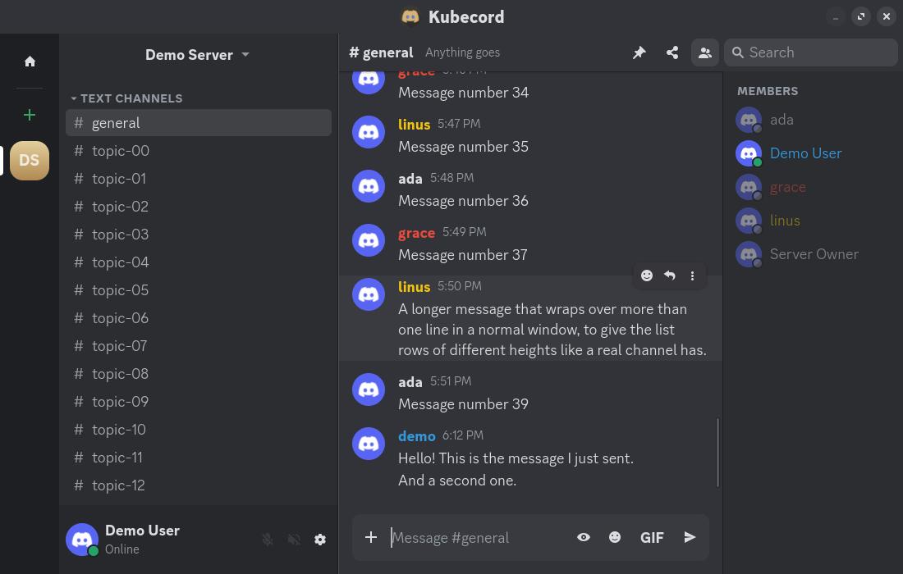

<div align="center">


# Kubecord

**A Discord client for Linux, built from scratch in Rust.**

Native GTK4/libadwaita. No Electron, no webview, no patched official client.

[](LICENSE)




<sub>Screenshot from the built-in demo mode (made-up data), with Discord's font and colors turned on.</sub>

</div>

---

The Linux community has been shackled by the official Discord client for far too long! I thought someone else would do it, but I guess if you want something done right (or done at all) you gotta do it yourself. Welcome to your liberation from Electron!

Please open issues if you have suggestions for features or find any bugs. I've tested the client extensively, but I'm sure I missed *something*.

## Contents

- [Quick start](#quick-start)
- [Is it safe to use?](#is-it-safe-to-use)
- [Features](#features)
- [Not supported yet](#not-supported-yet)
- [Tips](#tips)
- [Building](#building)
- [Files](#files)
- [Development](#development)
- [License](#license)

## Quick start

```sh
nix run github:kyleraykbs/Kubecord
```

Then log in with your **email and password** (2FA, SMS codes and captchas are
handled) or paste a **user token**. Only the resulting token is kept: your
password and codes are never stored or logged.

## Is it safe to use?

> [!WARNING]
> Third-party clients are *kinda* against Discord's Terms of Service and *can*
> get an account banned. The risk is quite low, as Discord mainly looks for
> self-botting and mass friending (for scam prevention). Kubecord does its best
> to use the API the way the official client does.

<details>
<summary><b>The Terms of Service lines this <i>may</i> touch, and why the risk is low</b></summary>

<br>

**"using any unauthorized software designed to modify the services"**

While there technically are modifications to the original intent, they are
minor. Many other projects like Vesktop and Vencord allow for plugin
modifications that do much more, and those are generally considered low risk.
This project is slightly more risky, as it recreates the API interaction in full
rather than tacking onto the existing app. Its modifications are basic and try
to be respectful, for example:

- Hide whether you're typing
- See stream details
- Search GIF favorites
- Keep a local log of deleted and edited messages (only what Discord already
  sends the client; nothing is fetched to log it)

**"scraping our services without our written consent, including by using any robot, spider, crawler, scraper, or other automatic device, process, or software"**

Kubecord doesn't automate any scraping or messaging. It simply lets *you*
interact with Discord just like you normally would.

**"copying, dismantling, or reverse engineering any of our services or using our intellectual property without permission"**

You aren't reverse engineering anything by using this client. We did use
*other people's* clients as a reference, and reverse engineering was required to
make them, but we never reverse engineered the Discord app itself. Clients like
Vesktop and Vencord did the same.

**"trying to gain access to, intentionally overburdening, or attacking our systems"**

Kubecord doesn't try to bypass any rate limits or flood Discord's servers. If a
limit isn't enforced on the client's side yet, though, it *could* look like that
to Discord, say if you spam somewhere with a rate limit I haven't implemented.

**In summary:** nothing here is malicious, and that's where the main ban risk
is. Discord tends to ban for MASS calls or really suspicious API behavior.
Kubecord tries to be respectful to the API, but I can't promise no call will
ever get flagged. From my own use, it seems very unlikely. Be respectful and a
ban is unlikely; friending people is the most likely place to get one.

</details>

## Features

### Voice and video
- Send and receive audio, see who's talking
- Per-user volume, boosted up to 5×
- Discord's own join, leave, mute and deafen sounds
- Screen share and webcam, **with audio**: the whole desktop, one window, or a
  dummy node for any patchbay
- The screen-share preview shows the *encoded* stream: what you see is what
  others see (barring connection stutters)
- Debug details for streams you share *and* streams you watch
- MANY fine-tunable settings (you're in full control)
- DM and group DM calls, showing when the other side is being rung
- Noise suppression, echo cancellation, automatic gain and input sensitivity

### Chat
- Send, edit, reply, react and pin
- Images, videos and GIFs, with a zooming viewer; right-click any of them to
  copy the link, open it in a browser or save it
- Embeds and attachments (with download), and previews of files before you send
- GIFs of every kind (MP4, GIF, …), with favorites and search (including partial
  favorites search, matched by link)
- Server and standard emoji with a picker, `:shortcode:` emoji as you type, and
  optionally Discord's own emoji artwork, even in the message box
- Stickers (all except Discord's stock ones)
- Spellcheck, with suggestions on right-click
- Typing indicators, with an option to hide your own
- **Apps and bots**: slash commands with autocomplete and file options; buttons,
  select menus and forms; app commands on users and messages
- **Message logger** (local only): keeps deleted messages (shown in red) and edit
  history, with separate keep times for text and media and size limits that drop
  the largest media first
- **Share mode**: pick a range of messages, redact or add single ones, and export
  it as a picture or text, to the clipboard or a file
- All available admin tools, including channel and server settings

### Profiles
- Edit your own profile; view anyone's
- Status, notes and bio
- Mutual friends and servers
- Basic activity support

### The app
- Not built in Electron! (Biggest feature of them all)
- Multiple accounts, with a default account to open on
- Notifications
- Follows your GTK colors (Stylix compatible), or Discord's own dark and light
  themes; Discord's font optional
- Transparent background with adjustable opacity
- Desktop entry and icon
- Extensive settings

## Not supported yet

- Discord's web activities (its golf game, chess, wordle, …)
- Animated profile overlays
- Lottie stickers (Discord's stock stickers)

## Tips

- **Default account:** in the account menu (your name at the bottom left), the
  star next to an account makes it the one Kubecord opens on.
- **Message logger:** on by default (text in the channel you're viewing is kept
  forever, everything else for less). Change it in *Settings → Message Logger*;
  set a kind to *Don't Log* to stop logging it.
- **Transparency on niri:** the compositor's border color can show through the
  whole window. Turn on *Settings → Theming → KDE Transparency Workaround*, or
  add a window rule to your niri config:

  ```kdl
  window-rule {
      match app-id=r#"^dev\.kyle\.kubecord$"#
      draw-border-with-background false
  }
  ```

  Leave the workaround off on KDE and sway, which would draw a second title bar.
- **Go Live audio** comes from your default output's monitor, which includes
  Kubecord's own sound. Route apps through a virtual sink and set
  `KUBECORD_MONITOR_DEVICE` to its monitor for a clean stream.

## Building

With Nix (recommended):

```sh
nix run              # build and run
nix build            # build; the result also installs the desktop entry and icons
nix develop          # a shell with everything for cargo
cargo run -p kubecord
```

The flake provides GTK4, libadwaita, GStreamer with the plugins Kubecord uses,
libopus and the Rust toolchain (1.92+). The packaged build wraps the GStreamer
plugin path and GTK schemas. New files need `git add` before `nix build`, as the
flake only sees tracked files. A Flatpak is planned.

## Files

| What | Where |
| --- | --- |
| Accounts (tokens, mode 0600) | `$XDG_CONFIG_HOME/kubecord/accounts.json` |
| Settings | `$XDG_CONFIG_HOME/kubecord/settings.json` |
| Message log | `$XDG_DATA_HOME/kubecord/logger/` |
| Image, emoji and font cache; log file | `$XDG_CACHE_HOME/kubecord/` |

Tokens are stored in plain text on purpose (a local, single-user client; a
keyring would add a daemon requirement), readable only by you.

## Development

### How it works

The UI is GTK4/libadwaita and inherits the system Adwaita colors, so it follows
your GTK theme. Media is GStreamer. Voice uses Discord's UDP voice protocol
directly: SRTP with `aead_xchacha20_poly1305_rtpsize` (or AES-256-GCM when
offered) and DAVE end-to-end encryption through the `davey` crate. Each account
has its own gateway connection, REST client and at most one voice connection.

### Layout

```
crates/kc-core      snowflakes, accounts, tokens, super-properties
crates/kc-http      REST v9, rate limits, uploads, app commands
crates/kc-gateway   user gateway, heartbeat, identify/resume
crates/kc-state     Discord models and the event reducer
crates/kc-voice     voice gateway, UDP/SRTP/RTP, DAVE, streams
crates/kc-media     GStreamer capture, Opus, H.264, rendering
crates/kc-ui        GTK4/libadwaita application
crates/kc-probe     protocol probe CLI
crates/kubecord     application entry point
data/               desktop entry and icons
```

### Demo mode

`KUBECORD_DEMO=<mode>` runs the interface against a made-up, offline account (no
Discord connection), for trying things out and taking screenshots. The modes are
listed at the top of `crates/kc-ui/src/demo.rs`.

```sh
KUBECORD_DEMO=default cargo run -p kubecord
```

### Protocol probe

`kc-probe` talks to Discord directly, without the interface:

```sh
KUBECORD_TOKEN=<token> cargo run -p kc-probe -- user
KUBECORD_TOKEN=<token> cargo run -p kc-probe -- guilds
KUBECORD_TOKEN=<token> cargo run -p kc-probe -- channels <guild-id>
KUBECORD_TOKEN=<token> cargo run -p kc-probe -- messages <channel-id>
KUBECORD_TOKEN=<token> cargo run -p kc-probe -- watch
KUBECORD_TOKEN=<token> cargo run -p kc-probe -- voice <guild-id> <channel-id>
KUBECORD_TOKEN=<token> cargo run -p kc-probe -- voice <guild-id> <channel-id> --stream --screen
```

`voice` joins a channel and speaks and receives; with `--stream --screen` it
starts a Go Live screen share through the XDG desktop portal. Add `--no-audio`
to test the voice handshake without opening the microphone or speaker.

## License

Kubecord is free software, licensed under the
[GNU General Public License v3.0 only](LICENSE). Copyright © 2026 kyleraykbs.

It is distributed in the hope that it will be useful, but WITHOUT ANY WARRANTY;
without even the implied warranty of MERCHANTABILITY or FITNESS FOR A PARTICULAR
PURPOSE. See the license for details.
